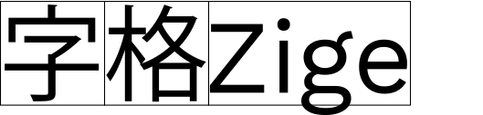
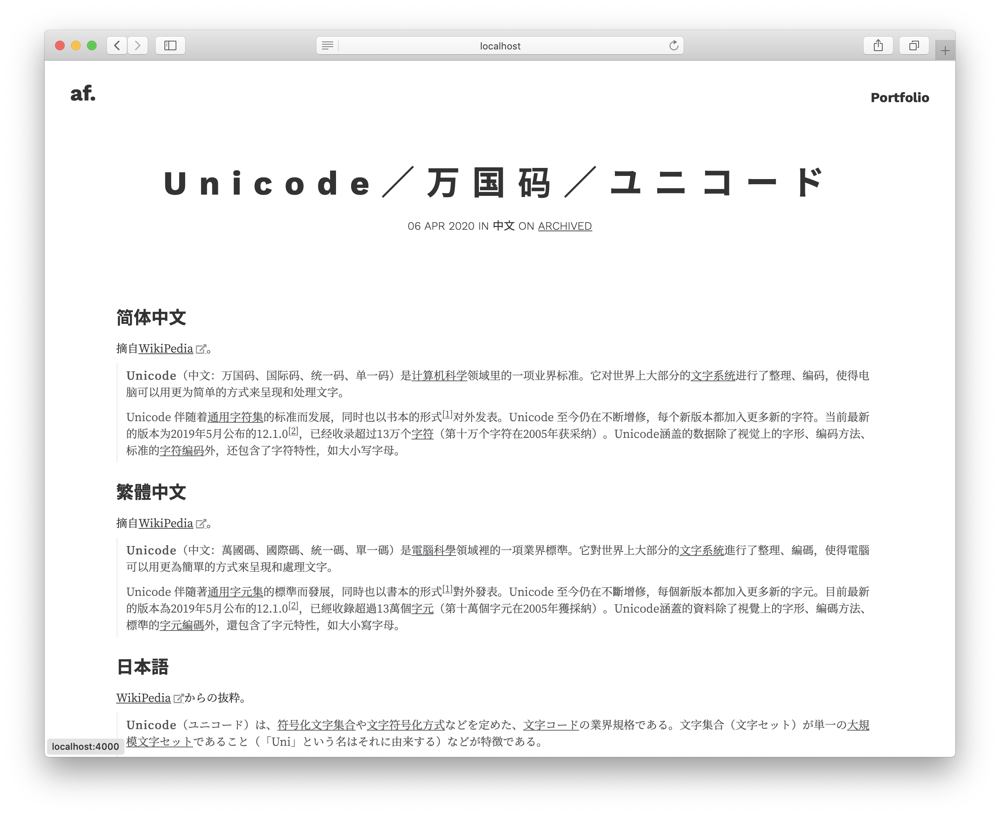
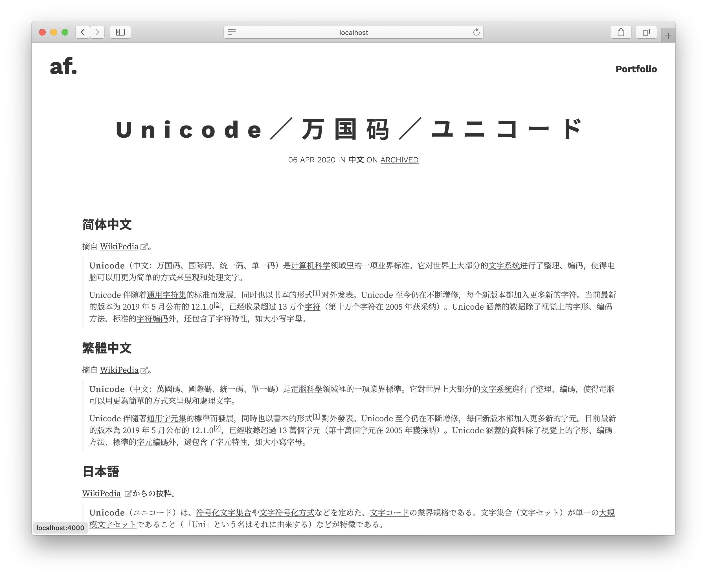

<h1>Zige 字格</h1>

<p>
<a href="https://cdn.jsdelivr.net/gh/zhenalexfan/zige.js/release/zige.min.js">
    
</a>
<a href="LICENSE">
    
</a>
</p>

<p width="400px">

</p>

[Aquí](https://zhenf.dev/2020/04/06/Space-muss-es-sein.html) lee más contexto en chino simplificado.

## ¿Qué es?

En tipografía, se necesitan ajustes de espacio entre caracteres, lo que también se conoce como [kerning](https://en.wikipedia.org/wiki/Kerning). Sin embargo, los navegadores web y los sistemas operativos modernos no lo aplican correctamente cuando los [caracteres CJK (漢字, ひらがな, カタカナ, etc.)](https://en.wikipedia.org/wiki/CJK_characters) y las letras latinas se mezclan en una página web. Si a ti también te molesta esto y estás de acuerdo con que ["la barra espaciadora no es una herramienta de diseño"](https://web.archive.org/web/20110319053039/https://hungermtn.org/the-space-bar-is-not-a-design-tool/), Zige te permite obtener un mejor espaciado entre caracteres CJK y latinos sin modificar el contenido del texto (es decir, ¡sin agregar [caracteres de espacio en blanco](https://en.wikipedia.org/wiki/Whitespace_character)!) en tu página web, simplemente añadiendo una línea de código.

<div align="center">


<br>
<p>Ejemplo de entrada de blog antes y después de usar Zige</p>
</div>

## Cómo usarlo

1. Añade `zige.min.js` a la etiqueta `<head>` de tu página web.

``` html
<script src="https://cdn.jsdelivr.net/gh/zhenalexfan/zige.js/release/zige.min.js"></script>
```

2. Si deseas aplicar Zige a toda la página web, ¡ya está! Si solo quieres corregir el espaciado dentro de algunos elementos padresa específicos específicos, añade `class="zige"` a ellos. Aplicarlo solo en los elementos que contienen caracteres CJK podría mejorar el rendimiento. A continuación se muestra un ejemplo.

``` html
<div class="zige"> <!-- Zige se aplica recursivamente a todos los elementos hijos dentro de este div -->
    <p>ウィキペディア日本語版は<a>2001年</a>5月頃に発足したものの⋯⋯</p>
</div>
```

3. Si deseas realizar más personalizaciones — como ajustar el tamaño del espaciado (0.25em por defecto), el nombre de la clase, etc. — lee la sección de Desarrollo a continuación.  

## Desarrollo

Edita las siguientes variables en `zige.js` para realizar las personalizaciones correspondientes.

|Nombre de variable   	|Comentario   	|
|---	|---	|
|`CLASS_NAME`   	|Nombre de la clase (`zige` por defecto) en los elementos raíz para los que se genera el espaciado.    |
|`SPAN_ATTR_NAME`   |Nombre del atributo (`zige-margin` por defecto) utilizado en los elementos `<span>` que envuelven el subcontexto alfabético dentro del contexto CJK. 	|
|`DEFAULT_AUTO_MARGIN_SIZE`  	|Tamaño del margen (`0.25em` por defecto) del subcontexto alfabético dentro del contexto CJK.  	|
|`CJK_SCRIPT`   	|Expresión regular para coincidir con todos los ideogramas CJK. *Podría necesitar amplia ser ampliada para usos más especializados.*   	|
|`CJK_SYMBOL`   	|Expresión regular para coincidir con todos los símbolos y signos de puntuación CJK, incluyendo la [puntuación general](https://www.unicode.org/charts/PDF/U2000.pdf) utilizada tanto en el contexto CJK como en el alfabético. *Podría necesitar ser ampliada para usos más especializados.*   	|
|`ALPHABET_SCRIPT`   	|Expresión regular para coincidir con todas las letras latinas. *Podría necesitar ser ampliada para usos más especializados.*   	|
|`ALPHABET_SYMBOL`      |Expresión regular para coincidir con todos los signos de puntuación latinos, incluyendo la [puntuación general](https://www.unicode.org/charts/PDF/U2000.pdf) utilizada tanto en el contexto CJK como en el alfabético. *Podría necesitar ser ampliada para usos más especializados.*      |

### Cómo funciona Zige

Zige envuelve los subcontextos latinos dentro de contextos CJK con etiquetas `<span>` y les añade `margin`s CSS.

Esta solución fue inspirada por las respuestas a [esta pregunta en Zhihu](https://www.zhihu.com/question/19587406) que sigo aproximadamente desde 2013, especialmente las respuestas de [钱争予](https://www.zhihu.com/question/19587406/answer/12863476) y [千鸟](https://www.zhihu.com/question/19587406/answer/12298384).

Aunque no creo que esta sea la solución definitiva al problema del kerning en la composición de caracteres de múltiples sistemas de escritura (debería ser resuelto por las tipografíassistemas operativos y las tipografíass), ¡podría ser una mejor solución en la web por ahora.

Si crees que las reglas de coincidencia pueden mejorarse para más caracteres diferentes o tienes algún problema, no dudes en enviar una pull request, crear un issue o [enviarme un correo electrónico](mailto:zhenalexfan@gmail.com)!
